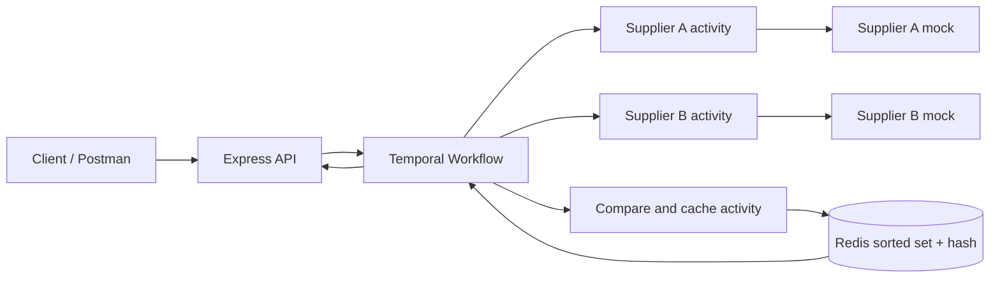

# Hotel Offer Orchestrator

A Node.js and TypeScript service that aggregates mock hotel inventory from two suppliers. It starts a Temporal workflow for each search, calls both suppliers concurrently, keeps the lowest offer for each normalized hotel name, and caches the de-duplicated result in Redis. Optional minimum and maximum prices are applied using Redis sorted-set range queries.

## Architecture



The `hotelOfferWorkflow` executes Supplier A and Supplier B activities in parallel with `Promise.allSettled`. Failed suppliers contribute no hotels rather than failing the entire workflow. Activities call the mock APIs, de-duplicate and compare offers, cache the result, and retrieve optional price ranges. A retry policy provides up to three attempts with exponential backoff.

## Tech stack

- Node.js 20 and TypeScript
- Express
- Temporal TypeScript SDK
- Redis 7
- PostgreSQL 14
- Docker and Docker Compose

## Prerequisites

- Docker Desktop or Docker Engine with Compose
- Node.js 20+ only for running locally without Docker
- npm

## Docker setup and run

```bash
cp .env.example .env
docker compose up --build
```

- API: http://localhost:3000
- Temporal UI: http://localhost:8080
- Temporal gRPC: localhost:7233
- Redis: localhost:6379

Stop the stack with `docker compose down`. Add `-v` to remove PostgreSQL and Redis volumes.

## Running locally without Docker

Start Redis and a Temporal server on ports 6379 and 7233, copy `.env.example` to `.env`, then run:

```bash
npm install
npm run build
npm start
npm run worker
```

The API and worker are separate processes. Run `npm start` and `npm run worker` in two terminals; `npm run dev` is available for API development with file watching.

## API reference

### Search hotels

```bash
curl "http://localhost:3000/api/hotels?city=delhi"
```

```json
[
  { "name": "Taj Avenue", "price": 4600, "supplier": "Supplier B", "commissionPct": 11 },
  { "name": "Holtin", "price": 5340, "supplier": "Supplier B", "commissionPct": 20 },
  { "name": "Radison", "price": 5900, "supplier": "Supplier A", "commissionPct": 13 },
  { "name": "The Imperial", "price": 8200, "supplier": "Supplier A", "commissionPct": 12 }
]
```

### Search by price range

```bash
curl "http://localhost:3000/api/hotels?city=delhi&minPrice=5000&maxPrice=6000"
```

```json
[
  { "name": "Holtin", "price": 5340, "supplier": "Supplier B", "commissionPct": 20 },
  { "name": "Radison", "price": 5900, "supplier": "Supplier A", "commissionPct": 13 }
]
```

Missing or invalid prices are handled as follows: missing city returns 400, negative or non-numeric prices return 400, and an inverted range returns 400. An unknown city returns `[]`.

### Supplier mock endpoints

```bash
curl "http://localhost:3000/supplierA/hotels?city=delhi"
curl "http://localhost:3000/supplierB/hotels?city=delhi"
```

### Health

```bash
curl "http://localhost:3000/health"
```

```json
{
  "status": "healthy",
  "supplierA": "healthy",
  "supplierB": "healthy",
  "redis": "healthy"
}
```

The endpoint returns HTTP 503 with degraded status when either supplier or Redis is unhealthy.

## Redis design

For each city, the cache uses:

- `hotel-offers:<city>`: a Redis sorted set with hotel normalized names as members and prices as scores.
- `hotel-names:<city>`: a Redis hash mapping normalized names to the final JSON offer.

For a price range, Redis executes `ZRANGEBYSCORE hotel-offers:<city> min max`; JavaScript then only deserializes the matching hash values. Filtering is not implemented with an array `.filter()` over the complete offer list.

## Design decisions and assumptions

- Names are trimmed, collapsed to a single space, case-folded, and used as normalized keys.
- The cheaper offer wins; when prices tie, Supplier A is kept because it is added first.
- Hotels found by only one supplier are retained.
- If one supplier is unavailable, the workflow caches and returns the other supplier's results.
- If both suppliers fail, the workflow caches an empty list and returns `[]`.
- Supplier A and Supplier B activities run concurrently.

For testing, a supplier can be marked down at runtime:

```bash
curl -X POST http://localhost:3000/api/test/supplier/a/down -H 'Content-Type: application/json' -d '{"down":true}'
curl "http://localhost:3000/api/hotels?city=delhi"
curl -X POST http://localhost:3000/api/test/supplier/a/down -H 'Content-Type: application/json' -d '{"down":false}'
```

## Testing

```bash
npm run build
npm test
```

Unit tests cover normalized de-duplication, cheapest-price selection, single-supplier hotels, and unknown cities.

Import [the Postman collection](postman/hotel-orchestrator.postman_collection.json) into Postman. Set `baseUrl` to `http://localhost:3000` if it is changed.

## Deployment

On a server with Docker and Docker Compose:

```bash
cp .env.example .env
# edit .env for the server
sudo docker compose up --build -d
sudo docker compose ps
```

Put an HTTPS reverse proxy in front of port 3000 for public deployment. Configure firewall rules for the API and block direct public access to Redis, PostgreSQL, and Temporal ports except when explicitly needed.

| Variable | Default | Purpose |
|---|---|---|
| PORT | 3000 | API listening port |
| REDIS_URL | redis://localhost:6379 | Redis connection used by API and worker |
| TEMPORAL_ADDRESS | localhost:7233 | Temporal server address |
| TEMPORAL_NAMESPACE | default | Temporal namespace |
| SUPPLIER_BASE_URL | http://localhost:3000 | Base URL used by supplier activities |
| SUPPLIER_A_DOWN | false | Start or run Supplier A in down mode |
| SUPPLIER_B_DOWN | false | Start or run Supplier B in down mode |
| POSTGRES_USER | temporal | PostgreSQL and Temporal setup user |
| POSTGRES_PASSWORD | temporal | PostgreSQL and Temporal setup password |

## Project structure

```text
.
├── src/
│   ├── server.ts       # Express API and mock suppliers
│   ├── worker.ts       # Temporal worker
│   ├── workflows.ts    # Hotel search workflow
│   ├── activities.ts   # Supplier, comparison, and Redis activities
│   ├── offers.ts       # Pure de-duplication and normalization logic
│   ├── redis.ts        # Redis sorted-set/hash cache
│   └── hotelData.ts    # Mock inventory
├── postman/
│   └── hotel-orchestrator.postman_collection.json
├── Dockerfile
├── docker-compose.yml
├── package.json
└── README.md
```
